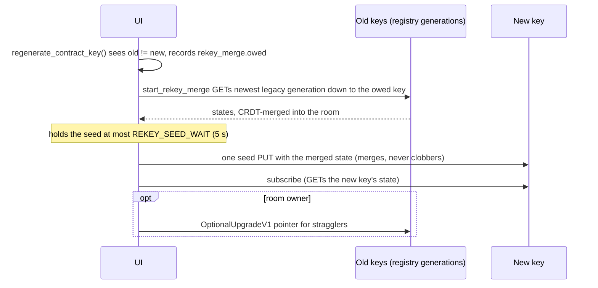

# Contract upgrade (WASM changes)

When the room contract WASM changes, the contract key changes: `key = BLAKE3(WASM_hash || params)`. The UI and riverctl both detect this with `regenerate_contract_key()`.

## Migration is permissionless

All room state is cryptographically self-authorized (AGENTS.md, "State authorization rule"), so:

- **Any node**, not only the owner, can GET state from the old key and PUT it to the new key. The new contract checks every signature and accepts it.
- The state must be canonical. `validate_state` accepts only states `post_apply_cleanup` leaves unchanged, compared as bytes. So a client sends `ChatRoomStateV1::normalized(&params)`, never raw old bytes, in any whole-state PUT or full-state UPDATE. freenet-core validates every incoming whole state before merging it, so every state a peer holds is canonical. Details: `.claude/rules/merge-laws.md`.
- The owner need not be online or do anything.
- The `OptionalUpgradeV1` pointer on the old contract is a courtesy for clients on old versions: it says where the new contract lives. Updated clients already know the new key from the WASM they bundle.

This works only while the state format stays backwards-compatible (AGENTS.md, "Backwards compatibility rule") and all state stays authorized.

## Upgrade flow for an updated UI (freenet/river#769)

1. On load, `regenerate_contract_key()` detects `old_key != new_key` and records the old key in `RoomData::rekey_merge.owed` (kept if an older merge is still owed). A room whose `previous_contract_key` is a registry generation also owes one merge from it, once (`RekeyMerge::previous_queued`). That recovers devices that re-keyed on a build without this merge (freenet/river#771).
2. Before the subscribe sweep, `process_rooms` holds the room `Subscribing` and `start_rekey_merge` GETs every generation from the newest legacy one down to the owed key, CRDT-merging what it finds. Then the room's seed PUT goes out once, carrying the merged state. A PUT onto a key someone already seeded merges, never clobbers. The subscribe that follows GETs the new key's state. A walk still running after `REKEY_SEED_WAIT` (5 s) seeds what the room holds and finishes in the background; what it merges later goes out as an ordinary update.
3. The marker clears only once the owed key itself returned the room's state and it merged. A slow, unreachable or `NotFound` old key seeds the local snapshot and is asked again, in the background (owed keys only), on later loads. A key is given up only after `MAX_UNFINISHED_REKEY_LOADS` (5) unfinished loads **and** `REKEY_GIVE_UP_AFTER` (3 days) since the room first owed it. **Do not seal on a `NotFound`**: on Freenet it is routinely a routing dead end, and this device synced the room under that key. Owed merges that do not block a seed (retries, the predecessor merge) run alongside the subscribe and never delay the room.
4. A room owner also sends an `OptionalUpgradeV1` pointer on the old key.

## Tabs that are already open

An open tab does none of this. It runs the build it loaded, with the old WASM compiled in.

- It notices a re-key through River's pointer records and reloads into the new build, which then runs the flow above (freenet/river#580, `ui/src/components/app/freenet_api/generation_watch.rs`).
- It reloads rather than following the new key in place, for the same reason riverctl restarts (`cli/src/pointer.rs`, `Recheck`): the new generation can change the state format and validation, and the delegate cannot be followed without the new build's migration.
- The reload is capped: tries per target with backoff, an hourly ceiling, one reload per page, never while the reader is busy. It goes through the shell's `navigate` so the old page's sockets close. Read the module docs before changing any of it.
- This is why `cargo make publish-pointer-records` is not optional after a re-key (`.claude/rules/river-publish.md`, step 7).
- Tabs on builds older than this mechanism (30000403 and earlier) need one manual reload.

The desktop app watches the same records. Once one is newer than the WASM it carries, it stops writing and asks the user to update (`apps/river-app/src/rooms/generation.rs`).
