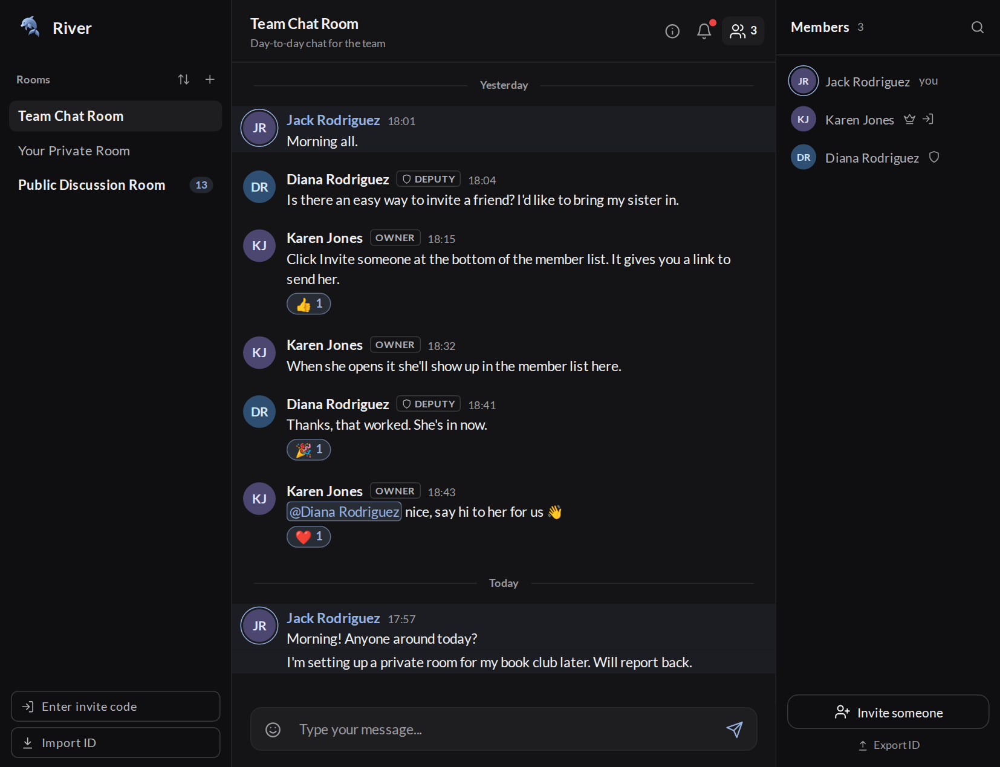

# River: group chat with no backend

River is a group chat app whose backend is a global peer-to-peer network instead of cloud servers.
Nobody runs a server for River, and nobody self-hosts. Every room lives on Freenet, a network
made up of the computers of the people who run it. The network caches and serves each room from
nodes near whoever is asking, so a busy room gets *more* capacity as it gets more popular. In the
server model, that traffic is a bill someone has to pay.



## Contents

- [Wait, no backend?](#wait-no-backend)
- [How it works](#how-it-works)
- [Why not Matrix, Discord, or Signal?](#why-not-matrix-discord-or-signal)
- [Features](#features)
- [Getting started](#getting-started)
- [Command-line client (optional)](#command-line-client-optional)
- [Building from source](#building-from-source)
- [Access control](#access-control)
- [Privacy model](#privacy-model)
- [Architecture](#architecture)
- [License](#license)

## Wait, no backend?

Most apps you use are shaped like this:

```
your browser  ──▶  servers you operate  ──▶  a database you operate
```

River is shaped like this:

```
your browser  ──▶  Freenet, a global peer-to-peer network
                   (that nobody operates for River)
```

There is no backend behind River that anyone runs or pays for. River is a chat app, and it also
shows that an application built this way needs no backend at all. You install Freenet once, and
any number of apps can run on it the same way.

River is decentralized in the original sense of the word: no servers, no company, and no
blockchain, token, or coins anywhere. It is code running on a shared network.

## How it works

On Freenet, the unit of deployment is a *contract*: a small piece of WebAssembly that defines what
valid state looks like and how it is allowed to change. A River room is one such contract. Its state
(members, messages, bans, encryption keys) lives on the network, replicated across the nodes that
care about it. Every change is cryptographically signed, so any node can verify it without
trusting anyone.

That design has three consequences:

- **A room outlives its creator's session.** It stays available on the network whether or not the
  person who made it is online.
- **Popularity adds capacity.** A room in demand is cached on more nodes, so it gets faster and more
  resilient as it grows, not slower.
- **State is self-validating.** Every message and membership change carries its own signature, so
  anyone can host or migrate a room's data without being able to forge it.

Freenet uses small-world routing, so any node can locate any contract in a logarithmic number of
hops. That is how River rooms scale without servers.

## Why not Matrix, Discord, or Signal?

Those systems decentralize to different degrees, but each keeps servers somewhere:

| System | Where the servers are | What River does instead |
|---|---|---|
| Discord, Slack, Signal | Central servers operated by a company | No company server. The Freenet network hosts each room |
| Matrix | Federated homeservers, each one run by someone | No homeserver to choose or operate |
| Nostr | Relays, which are servers | No relays. Nodes cache the rooms people ask for |
| Briar, Tox | None, but device to device, so both parties must be online | Rooms persist on the network when their creator is offline |

## Features

- Real-time group chat
- Public rooms and private rooms (end-to-end encrypted)
- One-click invite links
- Invitation-tree moderation (manage or ban anyone you invited, or anyone downstream)
- Runs in the browser, on desktop and mobile
- Scriptable from the command line with `riverctl` (useful for bots and AI agents)

## Getting started

The only thing you need to use River is Freenet. There is no River server to sign up for and no
account to create.

1. Install Freenet by following the [quickstart guide](https://freenet.org/quickstart/).
2. Click the invite link on that page to join the official River room.

River opens in your browser and works on both desktop and mobile. From there you can create your
own rooms and share their invite links. To join someone else's room you need an invitation from a
current member.

## Command-line client (optional)

`riverctl` drives River rooms from a terminal or a script, for automation, bots and AI agents. It
needs the [Rust toolchain](https://rustup.rs/). Install it with `cargo install riverctl`, then see
[cli/README.md](cli/README.md) for its commands and JSON output.

## Building from source

You only need this to work on River itself. Using River needs nothing but Freenet (above).

1. Install dependencies:

   ```bash
   # Install Rust using rustup
   curl --proto '=https' --tlsv1.2 -sSf https://sh.rustup.rs | sh

   # Add the wasm target
   rustup target add wasm32-unknown-unknown

   # Install the OpenSSL development library (Ubuntu shown; varies by system)
   sudo apt-get install libssl-dev

   # Install Node.js (v20+) and npm from https://nodejs.org/en/download.
   # System packages (e.g. `apt-get install npm`) may ship versions too old to work.

   # Install build tools. dx must be the exact dioxus version Cargo.lock
   # resolves (`cargo make check-dx-version` checks it; every build runs it).
   cargo install --locked dioxus-cli@0.7.10
   cargo install --locked cargo-make
   ```

2. Clone, install the Tailwind CSS dependencies, and start the development server:

   ```bash
   git clone git@github.com:freenet/river.git
   cd river
   cd ui && npm install && cd ..
   cargo make dev-example
   ```

3. Open http://localhost:8080 in your browser.

Two UI features control where the data comes from. `example-data` fills the UI with sample rooms
and messages. `no-sync` turns off the connection to Freenet. Each task below sets them:

| Task | Example data | Freenet sync |
|---|---|---|
| `cargo make dev` (development server) | No | On |
| `cargo make dev-example` (development server) | Yes | On |
| `cargo make build-ui-example` | Yes | On |
| `cargo make build-ui-no-sync` | No | Off |
| `cargo make build-ui-example-no-sync` | Yes | Off |

## Access control

River manages room membership with an **invitation tree**. The room owner sits at the root, and
any member can invite others, creating branches. A member can manage or ban anyone they invited,
or anyone further down their branch, so authority cascades down the tree.

For example, alice invited bob, who then invited charlie. Alice can ban charlie directly, because
charlie is downstream of her in the tree:

```
Room: freenet (Owner: owner)
├─── User: alice
│    ├─── User: bob
│    │    └─── Banned User: charlie
│    ├─── User: dave
│    └─── User: eve
└─── User: frank
```

## Privacy model

Anyone with a public room's contract address can read it. Private rooms are end-to-end encrypted.

### What private rooms hide, and what they don't

Private rooms encrypt every message body, every member nickname, and the room's name and
description with a member-only AES-256-GCM secret. Without that secret, none of that content is
readable: not by the network, not by Freenet nodes, not by anyone who happens to be storing the
contract. The owner distributes the secret to each member with ECIES (X25519 + AES-256-GCM). The
owner's client rotates it when the member set changes, immediately when a member is banned, and
on demand.

We use a shared room secret with rotation rather than a per-message ratcheting scheme like
Signal's double ratchet or MLS. The shared-secret design fits Freenet's state-based contract
model: any member can decrypt the room's current state and history on demand without needing to
be online for every message. The cost is the finer-grained forward secrecy those protocols provide
between rotations.

What private rooms *don't* hide is metadata. Anyone who can read the room's contract from the
network sees the visible column:

| Hidden | Visible |
|---|---|
| Message bodies | That the room exists |
| Member nicknames | How many members it has, and the shape of the invitation and ban tree |
| Room name and description | The size of each message and roughly when it was sent |
| | Overall activity volume and patterns |

Each member is identified by a per-room key, not a global identity, so those keys don't by
themselves link a member to anything outside the room. If your threat model requires
unobservability, not just confidentiality, River alone is not sufficient today.

## Architecture

### Project structure

| Directory | What it holds |
|---|---|
| [common](common/) | `river-core`: room state types and crypto helpers shared by the contracts, delegate, UI and CLI |
| [contracts](contracts/) | `room-contract` (one room's state) and `web-container-contract` (serves the compiled UI from Freenet) |
| [delegates/chat-delegate](delegates/chat-delegate/) | Private per-user storage on the user's own node: rooms, signing keys, and secret rotation |
| [ui](ui/) | Web UI, built with [Dioxus](https://dioxuslabs.com) and compiled to WebAssembly |
| [cli](cli/) | `riverctl`, the command-line client |
| [apps](apps/) | Native desktop app, in a separate Cargo workspace with its own `Cargo.lock` |

Contract state is composed with [freenet-scaffold](https://github.com/freenet/freenet-scaffold),
signed with elliptic-curve keys, and stored as CBOR (via [ciborium](https://crates.io/crates/ciborium)).

### Contract state

The room contract uses Freenet's composable state pattern. The core state structure is defined in
[common/src/room_state.rs](common/src/room_state.rs):

```rust
pub struct ChatRoomStateV1 {
    pub configuration: AuthorizedConfigurationV1, // Owner-signed room settings
    pub bans: BansV1,                             // Banned members
    pub members: MembersV1,                       // Members and who invited them
    pub ban_evidence: BanEvidenceV1,              // Absent members a stored ban still needs
    pub member_info: MemberInfoV1,                // Nicknames, set by each member
    pub secrets: RoomSecretsV1,                   // Secret distribution for private rooms
    pub recent_messages: MessagesV1,              // Recent messages, capped by configuration
    pub direct_messages: DirectMessagesV1,        // Encrypted direct messages between members
    pub upgrade: OptionalUpgradeV1,               // Pointer to a replacement contract
    pub version: StateVersion,                    // State format version
}
```

Each field's type has its own module under [common/src/room_state/](common/src/room_state/), in
field order: [configuration](common/src/room_state/configuration.rs),
[ban](common/src/room_state/ban.rs), [member](common/src/room_state/member.rs),
[ban_evidence](common/src/room_state/ban_evidence.rs),
[member_info](common/src/room_state/member_info.rs), [secret](common/src/room_state/secret.rs),
[message](common/src/room_state/message.rs),
[direct_messages](common/src/room_state/direct_messages.rs),
[upgrade](common/src/room_state/upgrade.rs) and [version](common/src/room_state/version.rs).

## License

River is open-source software licensed under the LGPL License. See [LICENSE](LICENSE) for details.
