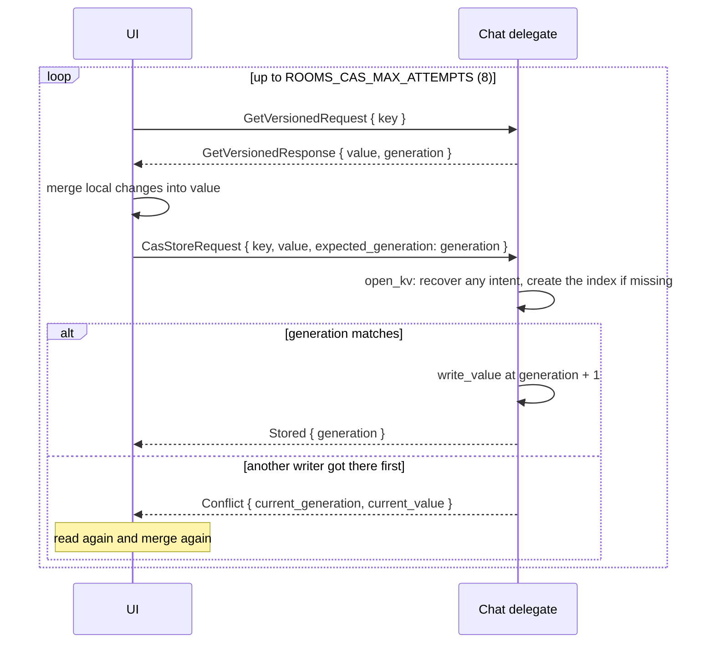

# Chat delegate

The chat delegate is River's private storage and signing service on the user's own Freenet node.
It has two jobs: a key-value store with compare-and-swap, and background secret rotation for private rooms the user owns.
It also holds each room's signing key and signs with it, so the private key never leaves the delegate.
It answers application messages from a web app origin, and contract notifications from the node (`process` in `src/lib.rs`).

## Requests

`ChatDelegateRequestMsg` and `ChatDelegateResponseMsg` live in `common/src/chat_delegate.rs`.
The handlers are in `src/handlers.rs`, except `EnsureRoomSubscription`, which is in `src/subscription.rs`.

| Request | What the delegate does | Answers with |
|---|---|---|
| `StoreRequest` | Stores the value unconditionally and bumps its generation | `StoreResponse` |
| `GetRequest` | Reads the value, without its generation | `GetResponse`, `value: None` when absent |
| `DeleteRequest` | Removes the value and drops the key from the index | `DeleteResponse` |
| `ListRequest` | Returns the keys in this origin's index | `ListResponse`, or an error starting with `LIST_REFUSED_MARKER` |
| `GetVersionedRequest` | Reads the value and its generation | `GetVersionedResponse`, generation `0` when absent |
| `CasStoreRequest` | Stores only if `expected_generation` matches the stored generation | `CasStoreResponse` with a `CasStoreResult` |
| `StoreSigningKey` | Stores a room's 32-byte signing key, overwriting any earlier one | `StoreSigningKeyResponse` |
| `GetPublicKey` | Derives the verifying key from the stored signing key | `GetPublicKeyResponse`, `public_key: None` when absent |
| `SignMessage`, `SignMember`, `SignBan`, `SignConfig`, `SignMemberInfo`, `SignSecretVersion`, `SignEncryptedSecret`, `SignUpgrade` | Signs the bytes it is given with the room's signing key. It does not decode them | `SignResponse`, echoing `request_id` |
| `EnsureRoomSubscription` | Records the room's contract ID and subscribes to that contract. It refuses when no signing key is on file | `EnsureRoomSubscriptionResponse`, plus a `SubscribeContractRequest` to the node |

`CasStoreResult` is `Stored { generation }`, `Conflict { current_generation, current_value }` or `Failed(String)`.
A conflict writes nothing.

## Origin partitioning

The node attests which web app sent a request (`MessageOrigin::WebApp`).
`check_origin` turns that contract ID into an `Origin` and rejects a missing origin or another delegate as caller.
`create_origin_key` prefixes every key-value key with the origin in base58 and the `:` separator (`ORIGIN_KEY_SEPARATOR`).
A web app with a different contract ID therefore reads and lists a different set of keys.

With an origin of `abc123`:

| Client key | Stored under |
|---|---|
| `user123` | `abc123:user123` |
| the key index (`KEY_INDEX_SUFFIX`) | `abc123:::key_index` |
| the crash-safety intent (`KV_INTENT_SUFFIX`) | `abc123:::kv_intent` |
| signing key for room `R` | `signing_key:abc123:R` (`create_signing_key_secret_key`) |

`create_origin_key` decodes the client key as lossy UTF-8.
Clients must use text keys: River encodes room keys and predecessor keys as base58 or hex for this reason.

## What River stores

| Key | Holds | Written by |
|---|---|---|
| `room:<base58 owner vk>` | One room as a `StoredRoomSlot`, present or tombstoned | `save_rooms_to_delegate` in the UI, and the native app, by CAS |
| `rooms_meta` | Current room, notification modes, room order | Same as above |
| `rooms_data` | The legacy single-blob room list | Nothing now. The UI reads it to migrate |
| `outbound_dms` | `OutboundDmStore`: plaintext of DMs the user sent, and archived threads | `save_outbound_dms_to_delegate`, by `StoreRequest` |
| `river_avatar_colour_seed_v1` | This device's avatar colour seed | `avatar_salt.rs`, by CAS |
| `\0freenet-migrate-journal/v1` | The migration journal (`MIGRATION_JOURNAL_KEY`) | `store_journal` in `delegate_migration.rs` |
| `__migrate_pred_done__:<hex>`, `__migrate_pred_wip__:<hex>` | Per-predecessor migration markers | The migration walk. The in-progress marker goes by CAS |
| `__river_migration_walk_skips__`, `__river_migration_topup_window__`, `__river_migration_short_index__` | Migration cadence and top-up bookkeeping | `delegate_migration.rs` |
| `signing_key:<origin>:<room>` | The room's signing key | `store_signing_key` in `ui/src/signing.rs`, and the native app |
| `room_sub:<room>`, `room_sub_by_cid:<contract>` | The subscription record and its reverse index | `handle_ensure_room_subscription` |
| `room_members:<room>`, `room_secret:<room>:<version>` | The last member set seen, and each secret a rotation derived | `handle_contract_notification` |

The first eight rows are key-value entries under the origin prefix, listed in the index.
Signing keys and rotation state are written directly, outside the index, and `ListRequest` never returns them.
Rotation state has no origin prefix: there is one subscription record per room.

## Write path

Every key-value value is stored in an envelope: a tag byte, a little-endian `u64` generation, then the data (`encode_versioned`).
`GetRequest` and `GetVersionedRequest` strip it, so clients never see it.
The UI's read-merge-write loop is `cas_write_key`:

Two tabs that write the same key can no longer overwrite each other: the stale one gets `Conflict` and merges.

A delete removes the envelope, so a re-created key starts again at generation 1.
River's UI never sends `DeleteRequest`, so no CAS key meets this today.
The module docs in `src/versioning.rs` say what a delete-safe CAS would need.

## Crash safety

A node restart can stop the delegate between any two writes.
The key-value handlers stay consistent anyway:

1. A write path creates the empty index before it writes any value (`get_key_index`). `ListRequest` on a fresh delegate writes nothing.
2. Storing a key the index does not list records an `Add` intent, writes the value, adds the key to the index, then clears the intent (`write_value`). A key already listed takes one write.
3. Deleting a listed key records a `Delete` intent, removes the key from the index, removes the value, then clears the intent (`handle_delete_request`). The index never lists a key with no value.
4. Store, CAS, delete and list first roll a recorded intent forward (`open_kv_with`). An `Add` indexes the key if its value landed. A `Delete` finishes the removal. Recovery is idempotent.
5. An index that does not decode is an error, never an empty index (`decode_key_index`).
6. An index that reads back absent beside a key River always stores (`INDEX_WITNESS_KEYS`) is a read fault. The delegate refuses the request rather than rewrite a short index.

Signing keys and rotation state are single writes outside this scheme.

## Rotation

The UI sends `EnsureRoomSubscription` for each room where it holds the owner's signing key.
The delegate refuses it until `StoreSigningKey` has stored that key.
The node then sends the delegate a `ContractNotification` whenever that room contract's state changes.
`handle_contract_notification` rotates the room secret when the room is private and its member set differs from `room_members:<room>`.
It derives the next secret with `derive_room_secret` at `current_version + 1`, and signs a `SecretVersionRecordV1` with the owner's key.
With the shared `build_rotation_encrypted_secrets`, it encrypts each secret version a current member or the owner is missing.
It emits one `UpdateContractRequest` whose delta carries only the secrets.
It always returns the update. A refused write of the local secret copy or of the member-set cache is logged as a warning (room and version only) and does not stop the rotation. The copy is never read back; the owner recovers every version from the room blob. If the cache write is refused, the next notification can rotate again, once per notification while writes stay refused. This is left as is, the same as before; the warning makes it visible. No check on room state alone can bound it, because room state erases a removed member's blobs.

The UI's fast path, `RoomData::rotate_secret`, calls the same two functions with the same inputs.
Both paths therefore emit byte-identical secrets and encrypted blobs.
Their version records differ only in `created_at`, and the contract keeps the record with the greater signature digest.
See [private-rooms.md](../../.claude/rules/private-rooms.md).

## Changing this crate

**Any change that alters `chat_delegate.wasm` changes the delegate key.**
That covers this crate, the parts of `common/` it compiles in, and the root `Cargo.lock`.
Without a migration entry, users lose their rooms.
Run `cargo make add-migration` before you rebuild, and follow [delegate-migration.md](../../.claude/rules/delegate-migration.md).
A new storage key also needs migration probes: see "Adding new storage keys" in [river-publish.md](../../.claude/rules/river-publish.md).
